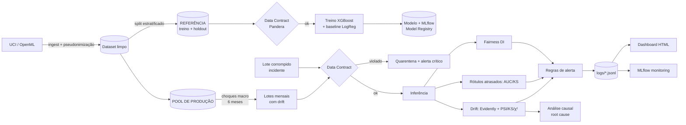

# Credit Scoring: Observabilidade, Drift, Qualidade de Dados e Governança (LGPD)

> **Tech Challenge, Fase 4 (MLET).** Camada de **sustentação e confiabilidade** de um modelo
> de Credit Scoring em produção: data contracts que bloqueiam lixo, simulação de degradação
> macroeconômica (data drift + concept drift), detecção estatística com Evidently AI,
> observabilidade centralizada (logs estruturados, MLflow, dashboard) e governança LGPD com
> análise causal.

    

> 📘 **Guia completo de execução:** [docs/GUIA_EXECUCAO.md](docs/GUIA_EXECUCAO.md). Ele cobre
> instalação, cada etapa, como abrir os gráficos e o MLflow, como explorar os dados, os
> cenários de simulação, a solução de problemas e um roteiro de demonstração.

---

## Sumário

1. [Contexto e solução](#1-contexto-e-solução)
2. [Arquitetura](#2-arquitetura)
3. [Como executar](#3-como-executar)
4. [Etapa 1: Data Contracts e modelo baseline](#4-etapa-1-data-contracts-e-modelo-baseline)
5. [Etapa 2: Simulação e detecção de drift](#5-etapa-2-simulação-e-detecção-de-drift)
6. [Etapa 3: Observabilidade](#6-etapa-3-observabilidade-de-pipelines-e-modelos)
7. [Etapa 4: Governança, LGPD e causalidade](#7-etapa-4-governança-lgpd-e-causalidade)
8. [Estrutura do repositório](#8-estrutura-do-repositório)
9. [Testes e qualidade](#9-testes-e-qualidade)

---

## 1. Contexto e solução

Uma fintech de crédito suspeita que seu modelo está **degradando silenciosamente** após
mudanças na economia (inflação, desemprego, novos perfis de clientes). Este projeto constrói
a camada que responde, com evidências, a três perguntas:

| Pergunta | Resposta no projeto |
|---|---|
| *Os dados que entram no modelo são confiáveis?* | Data contract Pandera com 10 regras rígidas; lotes inválidos são **bloqueados** e vão para quarentena |
| *O modelo ainda funciona?* | PSI/KS por feature, drift do score e performance com rótulos atrasados, em série temporal |
| *Por que degradou e estamos em conformidade?* | Análise causal por intervenção + plano LGPD, base legal, retenção e auditoria de vieses |

**Dataset:** [Default of Credit Card Clients](https://archive.ics.uci.edu/dataset/350/default+of+credit+card+clients)
(UCI / OpenML id 42477), com 30.000 clientes, alvo binário = inadimplência no mês seguinte,
22% de taxa de default. Baixado automaticamente na primeira execução.

## 2. Arquitetura



Princípios:

* **Separação física Referência × Produção**: `data/reference/` (congelado, usado no treino) e
  `data/production/` (lotes futuros, onde o drift ocorre). Nenhum dado de produção toca o treino.
* **Configuração centralizada**: todos os thresholds, choques e hiperparâmetros em
  [`config/config.yaml`](config/config.yaml).
* **Observabilidade nunca derruba o pipeline**: se o MLflow estiver indisponível, o pipeline
  segue e registra um warning.
* **Reprodutibilidade**: seed única, um comando reconstrói tudo.

## 3. Como executar

Pré-requisitos: Python 3.11+ (testado em 3.13). As versões fixadas em `requirements.txt`
evitam a resolução lenta de dependências entre MLflow e Evidently.

```bash
python -m venv .venv
```

```bash
# Windows: .venv\Scripts\activate   |   Linux/macOS: source .venv/bin/activate
pip install -r requirements.txt
```

```bash
pip install -e . --no-deps
```

```bash
credit-monitor all
```

O comando `all` executa, em ordem, `prepare`, `train`, `contract-demo`, `simulate`,
`monitor` e `dashboard` (cerca de 1,5 min; a primeira execução é um pouco mais lenta). Cada etapa também pode ser executada isoladamente
(`credit-monitor train`, `python -m credit_monitoring monitor` etc.) ou via `make`.

Saídas principais:

| Artefato | Caminho |
|---|---|
| **Dashboard de observabilidade** | [`reports/monitoring_dashboard.html`](reports/monitoring_dashboard.html) |
| Relatórios Evidently (drift por mês + completo) | [`reports/drift/`](reports/drift/) |
| Relatórios dos data contracts | [`reports/data_contracts/`](reports/data_contracts/) |
| Histórico do monitoramento | [`reports/monitoring_history.csv`](reports/monitoring_history.csv), [`reports/monitoring_summary.json`](reports/monitoring_summary.json) |
| Logs estruturados | [`logs/`](logs/) (`stages`, `metrics`, `alerts`, `pipeline` em JSON Lines) |
| MLflow | `mlflow ui --backend-store-uri sqlite:///mlflow.db` e abrir http://127.0.0.1:5000 |
| Explorador de dados no terminal | `python scripts/explore_data.py` (subcomandos: `referencia`, `producao`, `lote <mês>`, `drift <mês>`, `quarentena`, `alertas`, `etapas`, `modelo`, `causa`) |

O passo a passo detalhado (incluindo cenários alternativos de simulação, como "só concept drift"
e "economia estável") está em **[docs/GUIA_EXECUCAO.md](docs/GUIA_EXECUCAO.md)**.

## 4. Etapa 1: Data Contracts e modelo baseline

### 4.1 Contrato `credit_scoring_contract_v1` (Pandera)

Definido em [`src/credit_monitoring/contracts/schemas.py`](src/credit_monitoring/contracts/schemas.py).
Validação com `lazy=True` (coleta **todas** as violações de uma vez) e política de bloqueio em
[`contracts/validate.py`](src/credit_monitoring/contracts/validate.py).

| # | Regra rígida | Motivação |
|---|---|---|
| R1 | Nenhum valor nulo | XGBoost aceitaria NaN silenciosamente |
| R2 | Idade entre 18 e 100 anos | crédito só para maiores de idade |
| R3 | Limite de crédito entre 10 mil e 1 milhão | faixa da política de crédito |
| R4 | Sem registros duplicados | reprocessamento infla volume e enviesa métricas |
| R5 | `customer_id` único e pseudonimizado (`cus_<hmac>`) | garante que nenhum ID real vazou |
| R6 | Domínios categóricos válidos (education, pay_status, sex, marriage, default) | mudança de sistema de origem |
| R7 | Valores monetários dentro de limites (pagamento ≥ 0) | estorno no campo errado, erro de unidade |
| R8 | Schema estrito: nenhuma coluna extra | **bloqueia vazamento de PII** (ex.: CPF) |
| R9 | Tipos inteiros, sem coerção silenciosa | quebra de contrato no produtor |
| R10 | Lote com ≥ 100 registros | extração truncada |

O **mesmo contrato** protege o treino (referência, com rótulo obrigatório) e a inferência
(produção, sem rótulo, que só chega depois).

### 4.2 Demonstração: lote corrompido bloqueado

`credit-monitor contract-demo` (e o incidente injetado no monitoramento) cria um lote com
nulos, menores de idade, idade 150, limite negativo, duplicatas, códigos inválidos,
pagamento negativo e **uma coluna `cpf`**. Resultado:

* a ingestão é interrompida (`DataContractViolation`), **nenhuma predição é gerada**;
* o lote vai para `data/quarantine/` com o CSV de falhas;
* alerta `critical` em `logs/alerts.jsonl` e status `blocked` em `logs/stages.jsonl`;
* relatório: [`reports/data_contracts/contract_demo_corrupted_batch.html`](reports/data_contracts/contract_demo_corrupted_batch.html).

**Resultado da última execução:** um lote de 1.015 registros gerou **869 violações em 9 das 10 regras**
(R1 a R9; a R10 não dispara porque o lote tem mais de 100 linhas). O mesmo incidente, injetado no
fluxo mensal como `2026-03-incident`, é bloqueado sem afetar os demais lotes. Veja o
[relatório do contrato](reports/data_contracts/contract_2026-03-incident.html).

### 4.3 Modelo baseline

O modelo é treinado **somente** com o Dataset de Referência (13.484 clientes; holdout de 4.495). Esse dataset
também passa pelo contrato antes do treino.

| Modelo | AUC | Gini | KS | F1 |
|---|---|---|---|---|
| Regressão Logística (baseline interpretável) | 0,714 | 0,428 | 0,375 | n/a |
| **XGBoost (modelo em produção)** | **0,770** | **0,539** | **0,413** | **0,540** (threshold 0,305) |

Fairness no holdout: Disparate Impact de 0,94 (sexo) e 0,88 (faixa etária), ambos acima de 0,80.

Detalhes no [Model Card](docs/model_card.md).

## 5. Etapa 2: Simulação e detecção de drift

### 5.1 Cenário simulado (6 meses, intensidade crescente)

[`drift/simulate.py`](src/credit_monitoring/drift/simulate.py) cria lotes mensais a partir do
pool de produção, aplicando choques macroeconômicos com intensidade
`[0; 0,1; 0,3; 0,5; 0,75; 1,0]`:

| Choque (intensidade 1,0) | Variáveis afetadas | Tipo |
|---|---|---|
| Inflação +45% nas faturas | `bill_amt_1..6` | data drift |
| Aperto de crédito -30% nos limites | `limit_bal` | data drift |
| Desemprego: 35% dos clientes com +1/+2 meses de atraso | `pay_status_1..3` | data drift |
| Capacidade de pagamento -35% | `pay_amt_1..6` | data drift |
| 40% de novos clientes jovens (21-30 anos) | `age`, `limit_bal` | data drift |
| Adimplentes sem atraso e com alta utilização passam a inadimplir (renda real corroída, **não observada** pelo modelo) | `P(default \| X)` | **concept drift** |

Os rótulos são gravados em arquivos separados (`<mês>_labels.parquet`) para simular o
**label delay**: o drift de dados e do score é detectado *antes* da inadimplência acontecer.

### 5.2 Detecção

* **Evidently AI:** `DataDriftPreset` com **PSI** (threshold 0,10) por mês e um relatório
  completo do último mês com o teste padrão do Evidently (KS / χ² / Wasserstein) +
  `ClassificationPreset` (concept drift).
* **Cross-check próprio** ([`drift/stats.py`](src/credit_monitoring/drift/stats.py)): PSI,
  Kolmogorov-Smirnov (numéricas) e χ² (categóricas) implementados do zero, para auditabilidade.

### 5.3 Resultados: o modelo degrada silenciosamente e o monitoramento detecta

| Mês | Intensidade | Features com drift (PSI ≥ 0,10) | PSI do score | AUC | KS | Default real | PD prevista | Status |
|---|---|---|---|---|---|---|---|---|
| *Referência* | - | - | - | *0,770* | *0,413* | *22,1%* | *22,1%* | - |
| 2026-01 | 0,00 | 0 | 0,01 | 0,773 | 0,416 | 22,1% | 21,5% | 🟢 healthy |
| 2026-02 | 0,10 | 0 | 0,02 | 0,765 | 0,408 | 24,4% | 23,4% | 🟢 healthy |
| 2026-03 | 0,30 | 3 | 0,08 | 0,716 | 0,341 | 28,8% | 27,0% | 🔴 degraded |
| 2026-03-incident | - | - | - | - | - | - | - | ⛔ blocked |
| 2026-04 | 0,50 | 4 | 0,14 | 0,700 | 0,315 | 33,9% | 27,9% | 🔴 degraded |
| 2026-05 | 0,75 | 10 | 0,27 | 0,668 | 0,247 | 39,0% | 31,8% | 🔴 degraded |
| 2026-06 | 1,00 | 11 | **0,49** | **0,640** | **0,204** | **45,5%** | 35,5% | 🔴 degraded |

**Features com drift no último mês** ([tabela completa](reports/drift/2026-06_drift_table.csv)):

| Feature | PSI | Teste | Média ref. / atual | Leitura |
|---|---|---|---|---|
| `pay_status_3` | **1,21** | χ² p<0,001 | -0,16 / 0,54 | atrasos (desemprego) |
| `pay_status_2` | **0,88** | χ² p<0,001 | -0,13 / 0,55 | atrasos |
| `limit_bal` | **0,75** | KS 0,32 p<0,001 | 166,6 mil / 93,1 mil | aperto de crédito + novo público |
| `pay_status_1` | **0,34** | χ² p<0,001 | -0,02 / 0,62 | atrasos |
| `age` | 0,25 | KS 0,23 p<0,001 | 35,1 / 31,7 | clientes jovens |
| `pay_amt_1..6` | 0,11-0,14 | KS p<0,001 | -35% | capacidade de pagamento |
| `bill_amt_1..6` | 0,05-0,07 | KS 0,10 p<0,001 | **+45%** | inflação (ver nota abaixo) |

Leituras importantes:

1. **Degradação silenciosa:** em 2026-02 a inadimplência já tinha subido 2,3 p.p. e a AUC já tinha caído, mas
   nenhuma regra disparou. É exatamente o cenário que a diretoria temia. A partir de 2026-03 o
   monitoramento acusa drift e queda de performance. O *prediction drift* cresce mês a mês e
   funciona como **sinal antecipado**, antes de os rótulos chegarem.
2. **O modelo subestima o risco** (PD prevista de 35,5% contra default real de 45,5%). Essa é a assinatura de
   concept drift, confirmada pela análise causal (§7.7).
3. **Por que dois testes:** a inflação elevou as faturas em 45%, mas o PSI ficou em torno de 0,06.
   A variável tem cauda pesada: muitos clientes têm fatura próxima de zero, e ela continua
   próxima de zero depois de um choque multiplicativo. O KS detecta a mudança com p<0,001. O PSI é
   o critério de negócio, porque não depende do tamanho da amostra; KS/χ² dão a confirmação estatística.
4. **Evidently × implementação própria:** os dois apontam o mesmo núcleo (`limit_bal`,
   `pay_status_1..3`, `age`). O PSI do Evidently usa outro *binning* e é mais conservador nas
   variáveis de pagamento: 6 colunas em 2026-06, contra 11 no PSI por quantis.

Relatórios Evidently: [2026-01](reports/drift/evidently_drift_2026-01.html) ·
[2026-02](reports/drift/evidently_drift_2026-02.html) · [2026-03](reports/drift/evidently_drift_2026-03.html) ·
[2026-04](reports/drift/evidently_drift_2026-04.html) · [2026-05](reports/drift/evidently_drift_2026-05.html) ·
[2026-06](reports/drift/evidently_drift_2026-06.html) · **[completo 2026-06 (drift + classificação)](reports/drift/evidently_full_2026-06.html)**

## 6. Etapa 3: Observabilidade de pipelines e modelos

Optamos pelas **duas** abordagens propostas: rastreamento com **MLflow** *e* dashboard
interativo open-source (Plotly, HTML autocontido).

| Camada | Implementação |
|---|---|
| Logs centralizados | `logs/pipeline.jsonl` (aplicação), `stages.jsonl` (tarefas), `metrics.jsonl`, `alerts.jsonl`, em JSON Lines com `run_id` para correlação; prontos para Datadog/Loki/ELK |
| Rastreamento de tarefas | context manager `track_stage()` mede status, latência, volume, CPU e memória de cada etapa |
| Ciclo de vida do modelo | MLflow `credit-scoring-training`: params, métricas, fairness, artefatos e **Model Registry** com tags de governança |
| Monitoramento contínuo | MLflow `credit-scoring-monitoring`: métricas por lote em `step` (PSI por feature, drift share, AUC, KS, DI etc.) + relatórios Evidently e logs como artefatos |
| Dashboard | [`reports/monitoring_dashboard.html`](reports/monitoring_dashboard.html): KPIs, status/latência das tarefas, volume, infraestrutura, contratos, heatmap PSI, performance, calibração, fairness, causa raiz e alertas |
| Alertas | regras declarativas (PSI, dataset drift, prediction drift, AUC, default rate, fairness) |

Definição completa das métricas e regras: **[docs/observability_metrics.md](docs/observability_metrics.md)**.

**Resultado da última execução:** 40 execuções de tarefas (38 `success`, 2 `blocked` pelo
contrato, nenhuma `failed`) e 22 alertas (16 críticos, 6 de atenção). O pipeline completo leva cerca de 90 s.

```bash
mlflow ui --backend-store-uri sqlite:///mlflow.db --port 5000
```

No MLflow, o experimento `credit-scoring-monitoring` mostra as métricas por lote como séries
temporais (`perf_auc`, `drift_share`, `prediction_psi`, `psi_<feature>` etc.). O experimento
`credit-scoring-training` mostra o modelo registrado com as tags de governança.

## 7. Etapa 4: Governança, LGPD e causalidade

### 7.1 Inventário de dados pessoais e classificação

| Dado | Classificação LGPD | Tratamento no projeto |
|---|---|---|
| ID do cliente | dado pessoal (identificador) | **pseudonimizado** na ingestão com HMAC-SHA256 + chave secreta (`PSEUDONYMIZATION_KEY`); o ID original nunca sai da camada de ingestão |
| Idade | dado pessoal | usada como feature (relevante para risco); relatórios usam **faixas etárias** (generalização) |
| Sexo, estado civil | dados pessoais com potencial discriminatório | **excluídos do modelo** (Fairness by Design); retidos segregados só para auditoria de viés |
| Limite, faturas, pagamentos, atrasos | dados financeiros pessoais | necessários à finalidade; nunca expostos em logs (logs só contêm agregados) |
| CPF, nome, endereço, contato | identificadores diretos | **não coletados**; o contrato (R8) bloqueia qualquer coluna fora do schema, então um `cpf` "vazado" derruba o lote |

> A LGPD não classifica sexo/estado civil como *dado sensível* (art. 5º, II), mas seu uso em
> decisão de crédito gera risco de discriminação (art. 6º, IX). Por isso o tratamento é o mais
> restritivo possível.

### 7.2 Base legal para a decisão de crédito

* **Art. 7º, X (proteção do crédito)**: base legal principal para tratar dados na análise de
  risco, inclusive sem consentimento; compatível com a Lei do Cadastro Positivo (Lei 12.414/2011).
* **Art. 7º, V (execução de contrato / procedimentos preliminares)** a pedido do titular
  (solicitação de crédito).
* **Art. 7º, II (cumprimento de obrigação legal/regulatória)**: guarda de registros exigida pelo
  Banco Central (ex.: Res. CMN 4.557/2017, sobre gestão de riscos; Res. CMN 4.658/2018 e BCB 85/2021, sobre
  segurança cibernética) e prevenção à lavagem de dinheiro (Lei 9.613/1998).
* **Consentimento não é a base adequada**: seria revogável a qualquer momento, inviabilizando a
  gestão de risco da carteira.

### 7.3 Princípios aplicados (art. 6º): Privacy by Design & by Default

| Princípio | Como foi implementado |
|---|---|
| Finalidade / adequação | dados usados exclusivamente para avaliação de risco de crédito |
| **Necessidade (minimização)** | apenas 21 features + ID pseudônimo; nenhum identificador direto |
| Qualidade dos dados | data contract com 10 regras rígidas, bloqueio e quarentena |
| Transparência | model card, importância das features, threshold versionado, este README |
| **Segurança** | pseudonimização HMAC com chave em secret manager; dados fora do Git (`.gitignore`); logs só com agregados |
| Prevenção | schema estrito (R8) impede vazamento de PII para o modelo |
| **Não discriminação** | atributos protegidos fora do modelo + Disparate Impact monitorado a cada lote (regra 4/5) |
| Responsabilização | trilha de auditoria: `run_id` correlaciona logs, MLflow, relatórios e versão do modelo |

**By Default:** a configuração padrão já é a mais protetiva: sem PII, schema estrito,
quarentena automática, dados não versionados, logs sem registros individuais.

### 7.4 Direitos do titular e decisões automatizadas (art. 18 e art. 20)

* **Revisão de decisão automatizada (art. 20):** toda negativa é encaminhável à mesa de crédito
  humana; o score é *apoio* à decisão.
* **Explicabilidade (art. 20, §1º):** o modelo é de árvores com importância de features
  versionada; os principais fatores (histórico de atraso, utilização do limite) podem ser
  informados ao titular sem revelar segredo comercial. Evolução recomendada: SHAP por cliente.
* **Acesso, correção e eliminação:** a reidentificação de um titular (para atender a um pedido)
  só é possível pela área responsável, que custodia a chave HMAC.

### 7.5 Plano de retenção

| Dado | Retenção | Justificativa | Descarte |
|---|---|---|---|
| Dados brutos de ingestão (`data/raw`) | até a pseudonimização + 30 dias | reprocessamento em caso de falha | exclusão segura |
| Dataset de referência (treino) | vida útil do modelo + 5 anos | auditoria/reprodutibilidade de modelo (Res. CMN 4.557) | exclusão ou anonimização |
| Lotes de produção e predições | 5 anos após o fim da relação | defesa em processos, exigência regulatória | anonimização (agregados) |
| Lotes em quarentena | 90 dias | investigação do incidente com o produtor | exclusão segura |
| Logs e métricas (agregados) | 5 anos | trilha de auditoria; não contêm dados pessoais | - |
| Chave de pseudonimização | rotação anual | rotacionar torna pseudônimos antigos não vinculáveis | destruição criptográfica |

### 7.6 Mitigação de vieses

1. **Exclusão** de `sex` e `marriage` das features (isso não basta sozinho, porque existem proxies).
2. **Monitoramento contínuo** de Disparate Impact por sexo e faixa etária e de *equal
   opportunity gap* (TPR) quando há rótulo, com alerta abaixo de 0,80.
3. **Gatilho de governança:** DI < 0,80 exige revisão do modelo pelo comitê de risco antes de
   novos ciclos de decisão.
4. **Evoluções**: reweighing/threshold por grupo avaliados juridicamente; teste de proxies
   (correlação de features com atributos protegidos).

**Resultado:** nos 6 meses, o DI ficou entre 0,90 e 0,99 para sexo e entre 0,81 e 0,95 para faixa
etária (só grupos com pelo menos 100 clientes entram no indicador). Nenhum alerta disparou. O ponto mais baixo,
0,81 em 2026-02, ficou perto do limite, o que mostra por que o acompanhamento precisa ser contínuo.

### 7.7 Análise causal da degradação

Resumo. A análise completa (DAG, hipóteses, método e resultados) está em
**[docs/causal_analysis.md](docs/causal_analysis.md)**.

| Componente (2026-06) | ΔAUC |
|---|---|
| Queda total (de referência para produção) | **0,130** (de 0,770 para 0,640) |
| Explicada por data drift (reparando todas as features com drift) | -0,010 |
| **Residual: concept drift** | **0,140** |

* **O data drift explica o *nível* do score, não a perda de discriminação.** Reparar as features
  traz a PD média de 35,5% para 20,5% (referência: 22,1%). `pay_status_1` responde por
  cerca de 48% do deslocamento do score, `limit_bal` por 17% e `pay_status_2` por 14%.
* **A perda de AUC é quase toda concept drift.** Mesmo com as distribuições restauradas,
  a AUC não volta. A relação entre perfil e inadimplência mudou: a renda real foi corroída pela
  inflação, e o modelo não observa essa variável.
* **Prescrição:** só retreinar, sem novas variáveis, não resolve. É preciso incluir renda e
  comprometimento de renda (Open Finance / Cadastro Positivo) e indicadores macro, recalibrar a
  PD e revisar o threshold. Detalhes em [docs/causal_analysis.md](docs/causal_analysis.md).

### 7.8 RACI de governança do modelo

| Atividade | Responsável | Aprovador | Consultado | Informado |
|---|---|---|---|---|
| Data contract / qualidade | Eng. de Dados | Data Owner (Crédito) | DPO | Ciência de Dados |
| Treino e validação | Ciência de Dados | Comitê de Modelos | Risco, DPO | Negócio |
| Monitoramento e alertas | MLOps | Head de Risco | Ciência de Dados | Negócio |
| Retreino / rollback | Ciência de Dados + MLOps | Comitê de Modelos | Risco | Negócio, DPO |
| Incidente com dados pessoais | DPO | Diretoria | Jurídico, Segurança | ANPD e titulares (art. 48) |

## 8. Estrutura do repositório

```
config/config.yaml                 thresholds, choques do cenário, hiperparâmetros
src/credit_monitoring/
    data/          ingest.py (download, limpeza, split), privacy.py (HMAC, generalização)
    contracts/     schemas.py (Pandera), validate.py (quality gate), corrupt.py (incidente)
    models/        train.py (XGBoost + LogReg, MLflow), metrics.py (AUC, KS, Gini)
    drift/         simulate.py (cenário macro), stats.py (PSI/KS/χ²), detect.py (Evidently)
    analysis/      fairness.py (Disparate Impact), root_cause.py (análise causal)
    monitoring/    telemetry.py (logs/métricas/alertas), alerts.py, monitor.py,
                   mlflow_tracking.py, dashboard.py
    cli.py         credit-monitor <comando>
scripts/explore_data.py            explorador dos dados e resultados no terminal
tests/                             contratos, drift, privacidade e fairness (pytest)
reports/                           dashboard, relatórios Evidently e de contratos (gerados)
logs/                              telemetria JSON Lines da última execução
docs/                              model card, métricas de observabilidade, análise causal
.github/workflows/ci.yml           lint + testes a cada push
```

## 9. Testes e qualidade

```bash
pytest -v
```

```bash
ruff check src tests
```

Os testes não dependem do download do dataset: cobrem **cada regra do contrato isoladamente**,
o bloqueio/quarentena do lote corrompido, PSI/KS, o efeito esperado de cada choque da
simulação, a pseudonimização e o cálculo de Disparate Impact. CI no GitHub Actions.

---

**Referências:** Yeh, I-C. & Lien, C. (2009) *The comparisons of data mining techniques for the
predictive accuracy of probability of default of credit card clients*; Lei 13.709/2018 (LGPD);
Lei 12.414/2011 (Cadastro Positivo); documentação Evidently AI, Pandera e MLflow.
