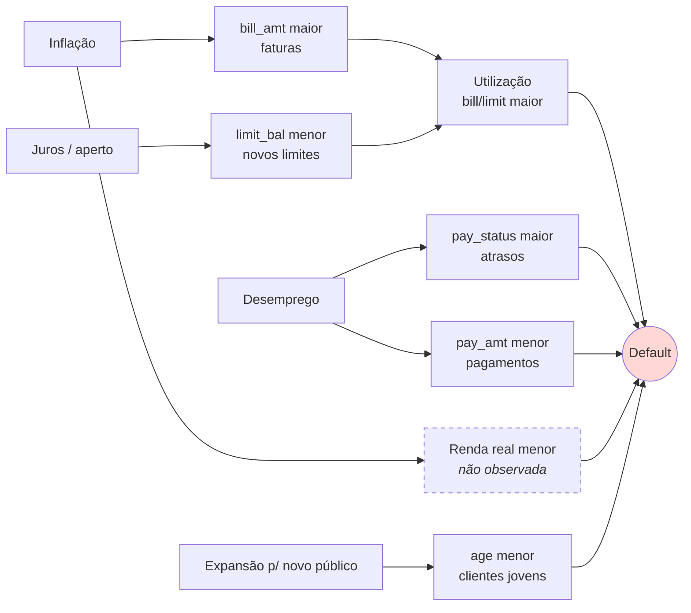

# Análise causal da degradação do modelo

> Pergunta da diretoria: *"o modelo está tomando decisões erradas por causa da economia?"*
> Detectar drift responde **o quê** mudou. Esta análise responde **por quê** e **o que fazer**.

## 1. Modelo causal do domínio (DAG)



Leitura:

* **Caminhos observados** (inflação, fatura, utilização e default; desemprego, atraso e
  default): o modelo *vê* essas variáveis. Quando elas mudam, o score reage. Isso é **data drift
  (covariate shift)**: `P(X)` muda, `P(y|X)` se mantém. O modelo continua "certo" para cada
  cliente, mas a carteira fica mais arriscada e a política (threshold) pode precisar de ajuste.
* **Caminho latente** (inflação, **renda real** e default): a renda real não é uma feature.
  Clientes sem atraso, mas com utilização alta, passam a inadimplir por perda de poder de
  compra. Para o modelo, eles parecem iguais aos bons pagadores do passado, mas `P(y|X)` mudou:
  **concept drift**. É a degradação *silenciosa* que a diretoria suspeita.

## 2. Hipóteses causais testáveis

| # | Hipótese | Evidência esperada | Instrumento |
|---|---|---|---|
| H1 | A inflação elevou faturas e utilização | PSI alto em `bill_amt_*`; média maior | Evidently / `drift_table` |
| H2 | O desemprego aumentou atrasos | PSI alto em `pay_status_1..3` | idem |
| H3 | O aperto de crédito e o novo público reduziram limites e idade | PSI alto em `limit_bal`, `age` | idem |
| H4 | O aumento de risco previsto é **causado** principalmente pelos atrasos | maior efeito causal no score para `pay_status_*` | intervenção (§3) |
| H5 | Parte da perda de AUC **não** é explicada pelas features | ΔAUC residual > 0 após reparar todas as features | decomposição (§3) |

## 3. Método: intervenção no modelo

Implementado em [`analysis/root_cause.py`](../src/credit_monitoring/analysis/root_cause.py):

1. Para cada feature `f` com drift, aplica-se uma intervenção que **troca a distribuição de `f` pela de referência**: cada valor de
   `f` no lote de produção é levado ao mesmo percentil da distribuição de referência
   (*quantile mapping*, que preserva a ordenação dos clientes, remove só a mudança de distribuição).
2. O lote é re-pontuado mantendo todo o resto fixo; a variação da PD média é o **efeito causal
   de `f` no score** (Δ score).
3. Reparando **todas** as features com drift ao mesmo tempo, obtém-se a decomposição:

```
ΔAUC_total     = AUC_ref - AUC_produção
ΔAUC_covariate = AUC_reparado - AUC_produção     (parcela explicada pelo data drift)
ΔAUC_concept   = AUC_ref - AUC_reparado          (resíduo: mudança em P(y|X), o concept drift)
```

**Limitações (honestidade metodológica):** a intervenção é sobre o *modelo*, não sobre a
economia. Ela identifica quais entradas movem o score, e a causa econômica vem do DAG de
domínio e de dados externos (IPCA, desemprego). Features correlacionadas (ex.: `bill_amt_1..6`)
dividem o efeito entre si; por isso também reportamos o reparo conjunto.

## 4. Resultados (lote 2026-06, intensidade máxima)

Fonte: [`reports/drift/2026-06_root_cause.csv`](../reports/drift/2026-06_root_cause.csv) e
`reports/monitoring_summary.json`.

### 4.1 Efeito causal de cada feature no score

| Feature | Δ PD média causada | % do deslocamento do score |
|---|---|---|
| `pay_status_1` | +0,064 | 48% |
| `limit_bal` | +0,023 | 17% |
| `pay_status_2` | +0,018 | 14% |
| `pay_status_3` | +0,006 | 5% |
| `pay_amt_*` (6 variáveis) | +0,009 somadas | 7% |
| `age` | praticamente zero | 0% |

PD média: 22,1% na referência, 35,5% em produção e **20,5% com todas as features reparadas**.

### 4.2 Decomposição da perda de performance

| Componente | ΔAUC |
|---|---|
| Queda total | 0,130 |
| Data drift (covariate) | -0,010 |
| **Concept drift (residual)** | **0,140** |

### 4.3 Veredito sobre as hipóteses

| # | Veredito |
|---|---|
| H1 | **Confirmada em parte.** As faturas subiram 45% (KS p<0,001), mas o PSI ficou baixo por causa da cauda pesada; o efeito no score é pequeno. |
| H2 | **Confirmada.** `pay_status_1..3` têm os maiores PSI (até 1,21). |
| H3 | **Confirmada.** `limit_bal` tem PSI de 0,75 e `age`, de 0,25. |
| H4 | **Confirmada.** Os atrasos (`pay_status_*`) causam cerca de 2/3 do aumento do score. |
| H5 | **Confirmada.** Mesmo com todas as distribuições restauradas, a AUC não se recupera: a perda de *ranking* vem de concept drift. |

**Conclusão para a diretoria:** a suspeita procede. O modelo está **subestimando o risco**
(PD prevista de 35,5% contra default real de 45,5%) e perdeu poder de discriminação (AUC de 0,770 para 0,640).
O modelo capta o aumento de risco *visível* (atrasos, limites). A parte *invisível* (renda real
corroída pela inflação) é a causa da perda de performance. Ela só se resolve com novas
informações no modelo, não apenas com retreino.

## 5. Prescrição

| Achado | Ação | Responsável | Prazo |
|---|---|---|---|
| Concept drift (renda real não observada) | Incluir variáveis de renda/comprometimento de renda (Open Finance, Cadastro Positivo) e índices macro (IPCA, desemprego) como features | Ciência de Dados | próximo ciclo |
| Data drift em atrasos e utilização | Retreinar com janela recente (últimos 6-12 meses) e reponderar a referência | Ciência de Dados + MLOps | imediato |
| PD subestimada (calibração) | Recalibrar (Platt/isotônica) em dados recentes e revisar threshold e provisões (IFRS 9 / Res. CMN 4.966) | Risco | imediato |
| Novo público jovem | Avaliar modelo/política específica para *thin file*; monitorar DI por faixa etária | Risco + Fairness | 1 mês |
| Prevenção | Champion/challenger contínuo; alerta de prediction drift como gatilho antecipado (antes do rótulo) | MLOps | contínuo |
