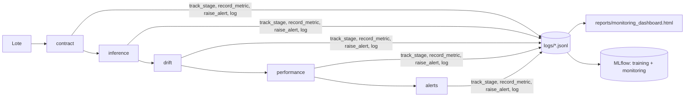

# Métricas de saúde operacional e alertas

Este documento define **o que** é medido, **onde** fica registrado e **quando** vira alerta.
Os thresholds ficam na seção `monitoring` de [`config/config.yaml`](../config/config.yaml).

## 1. Arquitetura de telemetria



Os logs são **JSON Lines estruturados**, o mesmo formato ingerido por Datadog, Grafana Loki,
CloudWatch e ELK. Levar para uma stack gerenciada exige apenas um agente apontado para `logs/`.

## 2. Métricas de pipeline e infraestrutura (`logs/stages.jsonl`)

| Métrica | Campo | Por que importa |
|---|---|---|
| Status de execução da tarefa | `status` ∈ `success` / `blocked` / `failed` | Falha silenciosa é o pior cenário; `blocked` = falha **controlada** (contrato) |
| Latência da tarefa | `duration_ms` | Detecta regressões de performance e risco de estourar SLA de decisão |
| Volume de entrada/saída | `rows_in`, `rows_out` | `rows_out < rows_in` revela perda de dados; lote bloqueado tem `rows_out = 0` |
| CPU consumida | `cpu_time_s` | Capacidade/custo; picos indicam lotes anômalos |
| Memória do processo | `memory_rss_mb` | Vazamentos de memória e dimensionamento de infraestrutura |
| Identificação | `run_id`, `stage`, `batch`, `timestamp` | Rastreabilidade ponta a ponta (correlação entre logs, métricas e MLflow) |

Tarefas instrumentadas: `ingest_download`, `ingest_prepare`, `split_reference_production`,
`data_contract_validation`, `model_training`, `drift_simulation`, `inference`,
`drift_detection`, `performance_evaluation`, `evidently_full_report`, `root_cause_analysis`.

## 3. Métricas de dados e modelo (`logs/metrics.jsonl` + MLflow `step` = lote)

| Grupo | Métrica | Fonte |
|---|---|---|
| Qualidade | `contract_passed`, `contract_violations`, `contract_rules_violated` | Pandera |
| Data drift | `psi` por feature, `dataset_drift_share` | PSI próprio + Evidently |
| Prediction drift | `prediction_psi` (PSI do score), `approval_rate` | sem depender de rótulo |
| Performance | `perf_auc`, `perf_ks`, `perf_f1`, `perf_recall`, `perf_precision`, `perf_brier` | rótulos com atraso |
| Negócio | `perf_default_rate` (observada) × `mean_score` (PD prevista) | calibração |
| Fairness | `fairness_di_sex`, `fairness_di_age_band`, `eo_gap_*` | auditoria de viés |

## 4. Regras de alerta (`logs/alerts.jsonl`)

| Tipo | Severidade | Regra |
|---|---|---|
| `data_contract_violation` | critical | qualquer regra R1-R10 violada: lote bloqueado e em quarentena |
| `feature_drift` | warning | 0,10 ≤ PSI < 0,25 |
| `feature_drift` | critical | PSI ≥ 0,25 |
| `dataset_drift` | critical | ≥ 30% das features com drift |
| `prediction_drift` | critical | PSI do score ≥ 0,20 |
| `performance_degradation` | warning / critical | queda de AUC ≥ 0,03 / ≥ 0,07 vs. referência |
| `default_rate_increase` | critical | inadimplência observada +5 p.p. vs. referência |
| `fairness` | warning | Disparate Impact < 0,80 (regra dos 4/5) |

**Status do modelo por lote** (dashboard): `healthy` (sem alertas) · `attention` (só warnings) ·
`degraded` (≥ 1 alerta crítico) · `blocked` (contrato violado, sem predição).

## 5. Por que PSI como critério principal?

PSI é a métrica de estabilidade populacional usada por bancos e reguladores em modelos de
crédito, é **independente do tamanho da amostra** (diferente do p-valor do KS, que com milhares
de registros acusa drift em diferenças irrelevantes) e tem faixas de decisão consolidadas.
O KS/χ² entra como confirmação estatística (`stat_drift` em `reports/drift/*_drift_table.csv`).

## 6. Como visualizar

```bash
# Dashboard estático (abre no navegador, offline)
start reports/monitoring_dashboard.html        # Windows  |  open/xdg-open no macOS/Linux

# MLflow (ciclo de vida do modelo + séries temporais de monitoramento)
mlflow ui --backend-store-uri sqlite:///mlflow.db --port 5000
```
